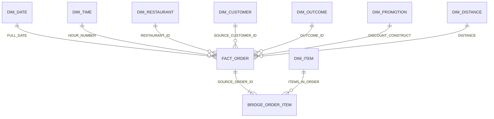

# Kho dữ liệu lịch sử đặt món: một FACT_ORDER

## Phạm vi và căn cứ thiết kế

Nguồn là `order_history_kaggle_data.csv` (21.321 đơn hàng, từ 01/09/2024 đến 31/01/2025). Cấu trúc bài làm tham khảo mục thiết kế kho dữ liệu và 15 câu truy vấn trong ba bài mẫu `[6]` (trang 19–20), `[15]` (trang 22–23), `[27]` (trang 36–37). Mức độ phân tích dựa trên **Bài 4** (bảng FACT/DIM, mô hình đa chiều), **Bài 6** (roll up, drill down, slice/dice, pivot) và **Bài 7** (truy vấn đa chiều, lọc, tổng hợp, TopCount). Các câu hỏi có thể làm bằng SQL Server, PivotTable hoặc chuyển sang MDX sau khi tạo cube trong SSAS.

## Dữ liệu đã xử lý

Chạy `python output/build_order_history_star.py` tại `D:\olap` để tạo lại 11 file CSV trong thư mục này. File nguồn không bị thay đổi.

- Đọc CSV UTF-8, kiểm tra `Order ID` duy nhất, chuyển ngày giờ sang ngày và giờ, chuyển tiền bằng `Decimal` để giữ chính xác đến 0,01 Rs.
- Tách `Items in order` theo mẫu `số lượng x tên món`. Chuẩn hóa khoảng trắng, dấu chấm cuối tên và khác biệt chữ hoa/thường; gộp cùng món xuất hiện nhiều lần trong một đơn. Kết quả có 218 món chuẩn hóa. File `order_items_cleaned.csv` thể hiện trực tiếp ba cột `source_order_ID`, `items_in_order`, `item_quantity`.
- Giữ nhãn khoảng cách nguồn; `<1km` được hiểu là dưới 1 km và có mã sắp xếp 0. Các nhãn `1km`, `2km`, ... có mã sắp xếp tương ứng. Không tự suy đoán khoảng cách chính xác.
- Phân nhóm khuyến mãi thành `None`, `Percentage`, `Flat amount`, `Buy 1 Get 1`, `Other`. Giữ cả chuỗi khuyến mãi gốc trong DIM_PROMOTION; đơn không có khuyến mãi (ô trống ở nguồn) ghi `DISCOUNT_CONSTRUCT = 'None'` để cột này làm khóa được.
- Đưa trạng thái, đánh dấu chuẩn bị món, lý do hủy/từ chối và nhãn khiếu nại vào DIM_OUTCOME. Các ô trống không được diễn giải thành “không có sự cố”; chúng chỉ có nghĩa là nguồn không ghi giá trị, nên `CANCELLATION_REJECTION_REASON` và `CUSTOMER_COMPLAINT_TAG` trống được ghi là `'Not recorded'` (cột NOT NULL, tránh nhầm NULL với “không có sự cố”).
- Không đưa `Instructions`, `Review` và `Delivery` vào kho: hai cột đầu là văn bản tự do không phục vụ 15 câu hỏi; `Delivery` chỉ có một giá trị.

**Kiểm tra chất lượng nguồn:** Không có Order ID trùng, không có chuỗi món không tách được. Có 80 đơn lặp cùng món trong chuỗi, đã cộng số lượng. Có 18 đơn mà `Bill subtotal + Packaging charges - tổng các giảm giá` lệch `Total` đúng 0,01 Rs; không sửa số gốc. Có 21 mã nhà hàng nhưng 24 cặp (mã, subzone), vì ba mã xuất hiện ở hai khu vực; vì vậy DIM_RESTAURANT dùng khóa số `RESTAURANT_ID`, còn cặp `(SOURCE_RESTAURANT_ID, SUBZONE)` là khóa duy nhất tự nhiên.

## Mô hình FACT_ORDER và bảng trung gian món



**Mức chi tiết của FACT_ORDER:** một dòng cho một đơn hàng, nên có đúng 21.321 dòng FACT. `SOURCE_ORDER_ID` là mã đơn nguồn và là khóa chính của FACT (degenerate dimension). Đơn hàng và món ăn có quan hệ nhiều–nhiều: một đơn gồm nhiều món, một món thuộc nhiều đơn. `BRIDGE_ORDER_ITEM` lưu cặp khóa `(SOURCE_ORDER_ID, ITEMS_IN_ORDER)` và `item_quantity` sau khi cộng món trùng trong cùng đơn. Đây là bảng liên kết, **không phải bảng FACT thứ hai**. `order_items_cleaned.csv` chỉ thể hiện kết quả tiền xử lý bằng tên món, không nạp thành bảng kho dữ liệu.

| Thành phần | Nội dung chính | Số dòng |
|---|---|---:|
| DIM_DATE | Ngày, tháng, quý, năm, thứ, cuối tuần (khóa `FULL_DATE`) | 153 |
| DIM_TIME | Giờ, buổi trong ngày (khóa `HOUR_NUMBER`) | 18 |
| DIM_RESTAURANT | Khóa số, mã nguồn, subzone, tên, city (khóa `RESTAURANT_ID`) | 24 |
| DIM_CUSTOMER | Mã khách hàng nguồn (khóa `SOURCE_CUSTOMER_ID`) | 11.607 |
| DIM_ITEM | Tên món đã chuẩn hóa (khóa `ITEMS_IN_ORDER`) | 218 |
| DIM_OUTCOME | Khóa số, trạng thái, chuẩn bị món, lý do, khiếu nại (khóa `OUTCOME_ID`) | 34 |
| DIM_PROMOTION | Chuỗi khuyến mãi, nhóm khuyến mãi (khóa `DISCOUNT_CONSTRUCT`) | 528 |
| DIM_DISTANCE | Nhãn khoảng cách, mã sắp xếp (khóa `DISTANCE`) | 22 |
| FACT_ORDER | Khóa chính `SOURCE_ORDER_ID`, giá trị các chiều, tiền/đánh giá/thời gian ở mức đơn | 21.321 |
| BRIDGE_ORDER_ITEM | Mã đơn, tên món, số phần món (khóa `SOURCE_ORDER_ID` + `ITEMS_IN_ORDER`) | 38.150 |

**Quy tắc cộng gộp:** `item_quantity` là số phần món trong bảng trung gian. Các khoản tiền cấp đơn (`bill_subtotal`, `packaging_charges`, `discount_total`, `total`) được giữ nguyên trên một dòng FACT_ORDER; không phân bổ tiền cho món vì nguồn không có đơn giá món.

Trên FACT_ORDER, `COUNT(*)` đếm đúng số đơn và `SUM(total)` cộng đúng giá trị đơn. Khi nối qua BRIDGE_ORDER_ITEM, mỗi đơn lặp theo số món; **không cộng tiền cấp đơn trên kết quả nối này**. Các truy vấn theo món chỉ cộng `item_quantity`; nếu cần đếm đơn theo món, mỗi cặp đơn–món là duy nhất nên `COUNT(*)` trên bridge cho ra số đơn chứa món. Chỉ 2.491 đơn có điểm đánh giá, nên truy vấn điểm đánh giá chỉ đại diện nhóm đã chấm điểm.

Các chiều khác nối trực tiếp FACT_ORDER vì mỗi đơn có một ngày, giờ, địa điểm nhà hàng, khách, nhóm kết quả, nhãn khuyến mãi và nhãn khoảng cách. Không cần thêm bảng trung gian cho các quan hệ này.

`Total` là giá trị ghi nhận trong CSV, kể cả đơn không giao thành công; không tự coi đó là doanh thu thực thu. Nếu báo cáo doanh thu giao thành công, thêm điều kiện `order_status = 'Delivered'`.

## 15 câu hỏi phân tích

Các câu SQL tương ứng nằm trong `queries_sql_server.sql`, đánh số 01–15 và có thể chạy riêng từng câu. Mức độ gồm tổng hợp `SUM`/`AVG`/`COUNT`, lọc, nhóm theo 1–3 chiều, sắp xếp và `TOP`, phù hợp các ví dụ trong bài giảng và bài mẫu.

| STT | Câu hỏi | FACT_ORDER: thuộc tính và vai trò | DIM: thuộc tính và vai trò | BRIDGE_ORDER_ITEM: vai trò |
|---:|---|---|---|---|
| 1 | Số đơn và tổng giá trị đơn hàng từng tháng thay đổi thế nào? | `FULL_DATE` nối ngày; mỗi dòng FACT là một đơn để đếm; `total` để cộng giá trị đơn. | **DIM_DATE:** `year_number`, `month_number` chia nhóm năm–tháng. | Không dùng. |
| 2 | Từng khu vực có bao nhiêu đơn và tổng giá trị theo tháng? | `FULL_DATE`, `RESTAURANT_ID` nối DIM; mỗi dòng để đếm đơn; `total` để cộng giá trị. | **DIM_DATE:** `year_number`, `month_number` chia nhóm thời gian. **DIM_RESTAURANT:** `subzone` xác định khu vực nhà hàng. | Không dùng. |
| 3 | 10 món ăn được đặt nhiều nhất là món gì? | Không dùng FACT_ORDER; truy vấn đi trực tiếp từ bảng bridge sang DIM_ITEM. | **DIM_ITEM:** `items_in_order` cho tên món để nhóm và hiển thị. | `ITEMS_IN_ORDER` nối món; `item_quantity` cộng số phần. Mỗi cặp đơn–món là duy nhất nên đếm dòng bridge để biết số đơn chứa món. |
| 4 | Nhà hàng có tổng giá trị đơn lớn nhất là nhà hàng nào? | `RESTAURANT_ID` nối DIM; `total` cộng giá trị đơn; mỗi dòng để đếm đơn. | **DIM_RESTAURANT:** `restaurant_name` nhóm các địa điểm cùng tên nhà hàng. | Không dùng. |
| 5 | Mỗi tháng, một đơn trung bình đặt bao nhiêu phần? | `SOURCE_ORDER_ID` nối bridge và đếm **đơn khác nhau**; `FULL_DATE` nối ngày. | **DIM_DATE:** `year_number`, `month_number` chia nhóm tháng. | `SOURCE_ORDER_ID` nối đơn; `item_quantity` cộng tổng số phần. Trung bình = tổng số phần / số đơn khác nhau. |
| 6 | Số đơn đã giao và từ chối thay đổi theo tháng ra sao? | `FULL_DATE`, `OUTCOME_ID` nối DIM; mỗi dòng để đếm đơn. | **DIM_DATE:** năm, tháng để chia nhóm. **DIM_OUTCOME:** `order_status` chỉ giữ `Delivered` và `Rejected`, rồi chia nhóm trạng thái. | Không dùng. |
| 7 | Mỗi loại khuyến mãi có bao nhiêu đơn và tổng mức giảm chiếm bao nhiêu phần trăm tiền tạm tính? | `DISCOUNT_CONSTRUCT` nối DIM; mỗi dòng để đếm đơn; `discount_total` là tiền giảm; `bill_subtotal` là tiền tạm tính. | **DIM_PROMOTION:** `promotion_type` chia nhóm loại khuyến mãi. | Không dùng. |
| 8 | TOP 3 nhà hàng có tổng phí đóng gói cao nhất? | `RESTAURANT_ID` nối DIM; `packaging_charges` cộng phí đóng gói. | **DIM_RESTAURANT:** `restaurant_name` nhóm các địa điểm cùng tên nhà hàng. | Không dùng. |
| 9 | Điểm đánh giá trung bình của các đơn đã đánh giá theo nhà hàng? | `RESTAURANT_ID` nối DIM; `rating_value` lọc đơn có điểm, tính trung bình và đếm số đơn đã đánh giá. | **DIM_RESTAURANT:** `restaurant_name` nhóm các địa điểm cùng tên nhà hàng. | Không dùng. |
| 10 | Mỗi khu vực phát sinh những loại khiếu nại nào và bao nhiêu đơn? | `RESTAURANT_ID`, `OUTCOME_ID` nối DIM; mỗi dòng để đếm đơn có khiếu nại. | **DIM_RESTAURANT:** `subzone` là khu vực nhà hàng. **DIM_OUTCOME:** `customer_complaint_tag` lọc nhãn khác `'Not recorded'` và chia nhóm loại khiếu nại. | Không dùng. |
| 11 | Thời gian chuẩn bị món trung bình theo từng khu vực là bao nhiêu? | `RESTAURANT_ID` nối DIM; `kpt_minutes` tính trung bình phút chuẩn bị và đếm đơn có ghi nhận thời gian. | **DIM_RESTAURANT:** `subzone` chia nhóm theo khu vực nhà hàng. | Không dùng. |
| 12 | Thời gian tài xế chờ trung bình theo từng khoảng cách giao hàng là bao nhiêu? | `DISTANCE` nối DIM; `rider_wait_minutes` tính trung bình phút chờ và đếm đơn có ghi nhận thời gian. | **DIM_DISTANCE:** `distance` chia nhóm khoảng cách; `distance_int` sắp xếp các nhóm. | Không dùng. |
| 13 | TOP 3 khách quay lại có tổng giá trị đơn cao nhất? | `SOURCE_CUSTOMER_ID` nối DIM; mỗi dòng để đếm đơn; `total` cộng giá trị đơn. Chỉ giữ khách có ít nhất 2 đơn. | **DIM_CUSTOMER:** `source_customer_ID` xác định và hiển thị mã khách. | Không dùng. |
| 14 | Buổi nào trong ngày có số lượng đơn nhiều nhất, phân biệt giữa ngày thường và cuối tuần? | `FULL_DATE`, `HOUR_NUMBER` nối DIM; mỗi dòng để đếm đơn, sau đó lấy buổi có số đơn cao nhất cho từng loại ngày. | **DIM_DATE:** `is_weekend` tách ngày thường/cuối tuần. **DIM_TIME:** `day_part` chia nhóm buổi trong ngày. | Không dùng. |
| 15 | 10 món được đặt nhiều nhất vào cuối tuần? | `SOURCE_ORDER_ID` nối bridge; `FULL_DATE` nối ngày. | **DIM_DATE:** `is_weekend = 1` chọn thứ Bảy/Chủ nhật. **DIM_ITEM:** `items_in_order` cho tên món. | `SOURCE_ORDER_ID`, `ITEMS_IN_ORDER` nối đơn–món; `item_quantity` cộng số phần; đếm dòng bridge để biết số đơn chứa món. |

Các cột khóa ngoại (`FULL_DATE`, `RESTAURANT_ID`...) trong FACT dùng để nối bảng, không phải số liệu cần cộng. Riêng câu 3 không cần FACT_ORDER vì bảng bridge đã chứa cặp đơn–món. Với câu 5, phải đếm `DISTINCT SOURCE_ORDER_ID` vì một đơn có thể có nhiều món.

Câu 4, 8 và 9 gộp các địa điểm có cùng `restaurant_name` để báo cáo theo tên nhà hàng. File `giai_thich_15_truy_van.txt` giải thích cách đọc và ý nghĩa từng câu SQL.

## Nạp vào SQL Server

1. Tạo cơ sở dữ liệu trống rồi chạy `schema_sql_server.sql`.
2. Nạp tám file `DIM_*.csv` vào bảng cùng tên, sau đó `FACT_ORDER.csv` và cuối cùng `BRIDGE_ORDER_ITEM.csv`. Đọc UTF-8, dòng đầu là tên cột, ánh xạ cột theo **tên** hoặc theo đúng thứ tự trong lược đồ. Chỉ `RATING_VALUE`, `KPT_MINUTES`, `RIDER_WAIT_MINUTES` của FACT_ORDER cho phép NULL (trường rỗng); các cột khóa không NULL, ô trống nguồn đã được thay bằng `'Not recorded'` hoặc `'None'` trong CSV.
3. Không nạp `order_items_cleaned.csv` thành bảng kho dữ liệu. Chạy `queries_sql_server.sql` để phân tích.

Đối chiếu sau khi nạp:

```sql
SELECT COUNT(*) AS orders, SUM(total) AS total_rs
FROM dbo.FACT_ORDER;
-- Kỳ vọng: 21321; 14554058.14

SELECT COUNT(*) AS order_item_pairs,
       COUNT(DISTINCT SOURCE_ORDER_ID) AS orders_with_items,
       SUM(item_quantity) AS food_units
FROM dbo.BRIDGE_ORDER_ITEM;
-- Kỳ vọng: 38150; 21321; 41287
```

## Quy ước tên thuộc tính

Kho dữ liệu **không dùng khóa tự đánh số cho các chiều có khóa nguồn gọn**: DIM_DATE, DIM_TIME, DIM_CUSTOMER, DIM_ITEM, DIM_PROMOTION, DIM_DISTANCE dùng mã/giá trị nguồn làm khóa chính và FACT giữ đúng các cột đó làm khóa ngoại, cùng tên với cột khóa của bảng chiều. Hai chiều có khóa nguồn không gọn là DIM_RESTAURANT (mã nguồn không duy nhất) và DIM_OUTCOME (4 cột) dùng khóa số `RESTAURANT_ID`, `OUTCOME_ID` (1..N); khóa tự nhiên của chúng được giữ bằng ràng buộc UNIQUE:

| Bảng | Khóa chính |
|---|---|
| DIM_DATE | `FULL_DATE` |
| DIM_TIME | `HOUR_NUMBER` |
| DIM_RESTAURANT | `RESTAURANT_ID` (UNIQUE: `SOURCE_RESTAURANT_ID` + `SUBZONE`) |
| DIM_CUSTOMER | `SOURCE_CUSTOMER_ID` |
| DIM_ITEM | `ITEMS_IN_ORDER` |
| DIM_OUTCOME | `OUTCOME_ID` (UNIQUE: 4 cột `ORDER_STATUS`, `ORDER_READY_MARKED`, `CANCELLATION_REJECTION_REASON`, `CUSTOMER_COMPLAINT_TAG`) |
| DIM_PROMOTION | `DISCOUNT_CONSTRUCT` |
| DIM_DISTANCE | `DISTANCE` (`DISTANCE_INT` chỉ để sắp xếp) |
| FACT_ORDER | `SOURCE_ORDER_ID` |
| BRIDGE_ORDER_ITEM | `SOURCE_ORDER_ID` + `ITEMS_IN_ORDER` |

Trong mỗi file CSV của DIM, các cột khóa đứng đầu, tiếp theo là các thuộc tính mô tả; thứ tự cột khớp với schema SQL. Thuộc tính DIM từ nguồn dùng chữ hoa và dấu gạch dưới thay khoảng trắng, bỏ dấu phân cách `/`: `DISTANCE`, `CANCELLATION_REJECTION_REASON`, `CUSTOMER_COMPLAINT_TAG`, `ITEMS_IN_ORDER`. Trong DIM_ITEM, `ITEMS_IN_ORDER` là tên từng món đã tách và chuẩn hóa từ cột Items in order, không phải toàn bộ chuỗi món của đơn. Thuộc tính suy ra (ngày, giờ, `PROMOTION_TYPE`) giữ tên mô tả riêng. `DISTANCE_INT` chỉ dùng sắp xếp; `<1km` tương ứng 0.

Hệ quả của việc bỏ khóa số ở các chiều còn lại: khóa chuỗi dài (mã khách 64 ký tự, tên món tới 200 ký tự trong bảng bridge) nên file và cube lớn hơn bản dùng số nguyên. Giữ khóa số cho nhà hàng và kết quả đơn tránh FACT phải mang khóa 2 cột và 4 cột.
